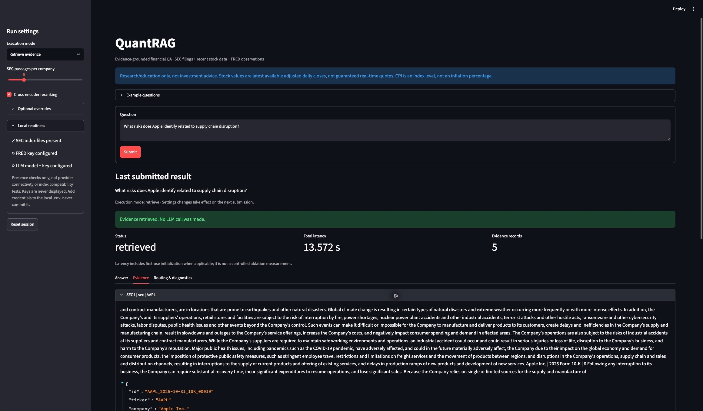

# Task 7/8 report sections

Updated 24 October 2026. Prepared for the shared report's Sections 6.3/6.4, 10, 11/13 and 15. The shared Google Doc is view-only for the current account, so this text has not been inserted there. Coordinate section ownership with the team before replacing any shared text.

The UI implementation and real SEC smoke checks are complete at the software-acceptance level. Final retrieval-quality and answer-quality experiments are not complete. Keep the pending tables out of a submitted final report until measured results exist; they are working templates, not findings. The earlier missing-corpus limitation no longer applies locally. See [the dated verification record](validation_2026-10-24.md).

## 10. User Interface (Q2)

### 10.1 Streamlit Interface

We implemented a lightweight Streamlit interface over the shared `RAGPipeline`, keeping retrieval and generation independent of presentation. Users can inspect a deterministic route plan, retrieve evidence without generation, or request an evidence-grounded answer. Optional controls include ticker, FRED indicator, filing-date year, filing form, passages per company and cross-encoder reranking. Submitting a form explicitly starts a run; inspecting previous evidence or downloading JSON does not trigger another generation request.

The interface exposes complete collected evidence, stable SEC passage IDs, filing/report dates, observation/trading dates and original-source links. It separately shows the exact bounded context supplied to the model and identifies cited records. Errors, partial coverage, insufficient evidence and generation failure remain visible rather than being converted into apparently complete answers. Prices are labelled as adjusted daily closes, and raw CPI observations are not presented as inflation percentages.

### 10.2 Example Interaction and Acceptance

For the question "What risks does Apple identify related to supply chain disruption?", the interface identifies a filing query for AAPL and returns five passages from the shared SEC index in Retrieve evidence mode. Each record exposes its stable passage ID, filing date, complete passage text and SEC filing link. Switching on reranking and submitting again loads the cross-encoder within the same session. Merely changing the checkbox leaves the previous result unchanged. A two-company question returns five passages per company, rather than five in total.

The supplied corpus contains no JPMorgan passages. A JPMorgan filing question therefore produces an explicit insufficient-evidence state instead of a supported-looking answer. The default demonstration questions use covered companies, while this missing-company case remains a separate acceptance check. Invalid year input clears the stale result and displays a validation warning. Resetting the session removes the reused pipeline and the previous result.

The implementation passed 109 automated tests and seven additional real-index Streamlit AppTest checks. These verify UI behavior and actual evidence retrieval, not relevance quality or live-provider answer correctness. No stock, FRED or LLM provider was called during the real-index acceptance run. Real generation and FRED acceptance remain pending local configuration. A retrieval screenshot must be captioned as retrieved evidence, not a generated answer. Add a real generated-answer and mixed/partial screenshot only after those backends are accepted, and archive the corresponding result JSON.

The page's latency is total pipeline latency, potentially including first-use model initialization; controlled experiments use a separate runner.

## 6.3 Five Query Examples and Speed: Current Smoke Check

Five illustrative questions cover Apple supply-chain disruption, Microsoft cloud revenue growth, NVIDIA export restrictions, Amazon fulfillment/logistics and Chevron commodity-price risks. On 24 October, each returned five complete passages with the expected company ticker. Following initialization (0.847 s) and one warm-up, their sequential, single-pass retrieval latencies were 0.2424, 0.2205, 0.2450, 0.2448 and 0.2383 s respectively. The run used hybrid RRF plus cross-encoder reranking at K=5, cached models and macOS arm64.

This small run demonstrates executable retrieval and records speed for the example questions. It is not the manually labelled test set, a repeated four-system comparison, a full-RAG latency measurement or a quality evaluation. No claim about relative retrieval quality or answer accuracy follows from these timings. Runtime versions, settings and the local evidence-file locations are recorded in `docs/validation_2026-10-24.md`.

## 6.4 Retrieval Ablation Method (Q3; Results Pending)

The implemented experiment runner compares BM25, dense BGE/FAISS, BM25+dense RRF without reranking, and RRF followed by a cross-encoder. The final experiment will use one fixed corpus/index version and the team's adjudicated query set, with identical metadata filters, candidate count, output depth and evaluation definitions across variants. Warm-up is excluded from repeated measurements; model/index initialization is reported separately. The runner retains full rankings, scores, passages, per-query metrics and environment/index manifests for reproducibility. The final run has not yet taken place because adjudicated qrels and the agreement summary are not available.

Precision and recall count relevance grades above zero as relevant. nDCG uses graded gains; MRR is computed over the saved retrieval depth, not the entire corpus. Recall is relative to the known judged relevant set. Unjudged passages are treated as zero for metric computation, so judged coverage and pooling limitations are reported alongside the scores. A pool drawn only from the full system's top five results may systematically favor that system and is not an adequate basis for strong conclusions.

| Variant | P@5 | R@5 | R@10 | MRR@depth | nDCG@10 | Mean / p95 latency | Judged coverage |
|---|---|---|---|---|---|---|---|
| BM25 | pending | pending | pending | pending | pending | pending | pending |
| Dense | pending | pending | pending | pending | pending | pending | pending |
| RRF | pending | pending | pending | pending | pending | pending | pending |
| RRF + rerank | pending | pending | pending | pending | pending | pending | pending |

Report the exact test-set size, number of judgments, positive-grade convention, candidate/reranking pool sizes, number of repeats, hardware and snapshot hashes. Include query-level failures and cases where reranking reduces quality; do not select only favorable examples or claim significance from a five-query pilot.

The current shared retriever constructor loads both index types and the dense encoder even for a BM25 query. The BM25 row therefore measures BM25-only query ranking after shared initialization, not the cold-start time or memory/dependencies of an independently deployed BM25 service.

## 9. Generation Evaluation: Prepared Protocol (Q4/Q5; Results Pending)

Use the same saved retrieval rankings to generate answers under a fixed model, system prompt and context budget. Mixed questions must reuse identical dated live-data snapshots across variants. Record model identity, provider-reported token usage, per-answer generation latency, output status and supplied/cited evidence. Repeating generation is still stochastic unless the provider supports and honors deterministic settings; state this limitation.

Annotators independently judge faithfulness, answer relevance, context precision and task quality using the documented rubric and blinded answer IDs. Report the number of unique held-out records, number of annotators, score coverage, agreement definition and actual measured agreement. At least 1,000 manually labelled records and at least 80% inter-annotator agreement are required by the assignment. Four variants of the same query do not create four independent held-out queries.

| Variant | Faithfulness | Answer relevance | Context precision | Task quality | Generation latency | Token usage |
|---|---|---|---|---|---|---|---|
| BM25 context | pending | pending | pending | pending | pending | pending |
| Dense context | pending | pending | pending | pending | pending | pending |
| RRF context | pending | pending | pending | pending | pending | pending |
| RRF + rerank context | pending | pending | pending | pending | pending | pending |

The supplied review tool reports manual rubric scores, not RAGAS scores. If a dedicated automatic metric is added, name its exact implementation/model and validate its limitations. For extractive questions with reference answers, add Exact Match/token F1 as appropriate; for open-ended financial synthesis, explain why the chosen reference-based and human metrics fit the task. Do not label citation-ID validity as semantic faithfulness.

The four context variants measure the downstream effect of retrieval composition and reranking. They do not isolate the effect of citation prompting, routing, live-data integration, or other generation innovations. If the report claims contributions from those additional innovations, add matched controls for each claim; otherwise describe them as implemented features without claiming an experimentally isolated gain.

## 11/13. Performance, Error Analysis and Limitations

Report sequential query latency and throughput with warm-up/initialization policy, token counts and failure rates. Serial reciprocal-latency throughput does not establish concurrent-user scalability. Report currency cost only using the actual provider/model price and date, not token counts alone. A single-machine local UI is not a load-tested production service.

Known limitations include heuristic routing, filing-date versus fiscal-year ambiguity, incomplete judgment pools, finite reranking depth, live-data availability and date drift, and the inability of citation validation alone to establish claim support. Offline tests verify interfaces and failure handling; they do not replace real-data retrieval/answer-quality evaluation.

The real-index checks also exposed a corpus-coverage limitation: a ticker listed in the configuration is not proof that its filings are present in the installed snapshot. Questions about absent companies must be distinguished from retrieval failures on covered companies. Changing the illustrative default questions does not correct the missing corpus coverage or justify removing unfavorable cases from the held-out evaluation.

## 15. Team Contributions: Wei Zhang

Wei Zhang implemented the Streamlit interface and its integration with the shared routing/RAG pipeline, the controlled four-configuration retrieval-ablation runner, the frozen-evidence answer-comparison and human-rating tools, and the related tests and documentation. He completed and submitted his independent Member 1 relevance annotations. He also verified real SEC retrieval/UI behavior and the five illustrative retrieval queries. Final experimental results and report interpretation remain to be completed after the evaluation owners finalize the labels; this entry does not claim that final ablations or human answer-quality evaluation have already been performed.
