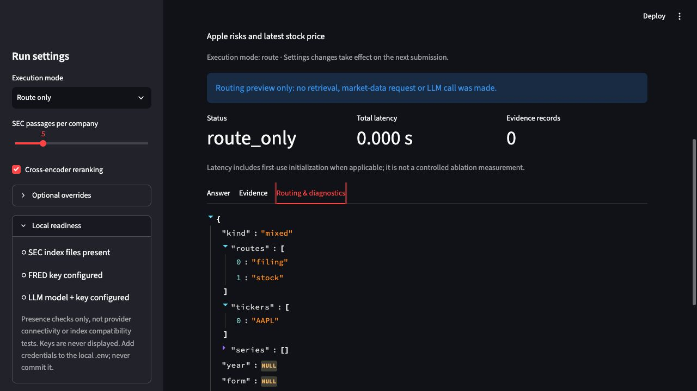

# Task 7/8 software verification - 2026-10-21

Initially verified on main commit `633e1b5`, then rechecked after pulling main and fast-forwarding `feature/streamlit-ui` through `9acd2f9` to `ae1d694`, using Python 3.11.17 and Streamlit 1.66.0. Verification was performed before the task 7/8 delivery commit. SHA-256 checks confirmed all 28 pre-existing modified/untracked files were unchanged during the first Git update; the verification record and handoff were subsequently updated to reflect new upstream artifacts.

## Passed checks

```text
python -m unittest discover -s tests -q
Ran 107 tests
OK

python -m pip check
No broken requirements found.

git diff --check
No whitespace errors.
```

Tests include the existing routing/generation/local-HTTP checks, four retrieval modes, reranking toggle/preload regressions, ablation metrics and exports, frozen-evidence answer studies, manual-rating aggregation, complete five-query exports, and Streamlit AppTest interactions/failure handling. Test completions, fake corpus records and fake human scores are synthetic fixtures, **not experimental project data**. The expected Streamlit `missing ScriptRunContext` messages come from the test harness, not a failed application test.

## Browser/CLI checks

- Re-ran all 107 tests after converting the UI, examples, router keyword lists/tests and handoff documentation to English. The generation prompt now requests English answers. A source/documentation scan found no remaining Chinese characters outside ignored environment/Git files, and the browser screenshot was replaced with the English-only version. The existing CI workflow now installs Streamlit to run the new UI tests.
- Opened the real Streamlit server on `127.0.0.1:8501`; submitted `Apple risks and latest stock price` in Route-only mode. The UI displayed a mixed `filing` + `stock` route and `AAPL`, without calling those backends.
- Submitted `Apple supply chain risks` in Retrieve-evidence mode on this machine without indexes. It returned explicit `insufficient_evidence` and the safe SEC-unavailable diagnostic instead of a traceback or a fabricated answer. The CLI produced the same failure state, with exit code 1. This checks the missing-artifact path, not retrieval quality.
- Validated the previously reviewed external five-query qrels file with `run_ablation --check-only`: 5 queries, 24 positive judgments, and explicit small-sample/small-pool warnings. No retrieval run or final quality metrics were produced. The file was not merged/copied into this branch.
- Passed the cross-module smoke check from synthetic `run_ablation` output to `answer_study prepare --check-only`: four cases, zero API calls, zero output files. Real ISO stock observation timestamps are covered by regression tests.
- After updating to `9acd2f9`, all 107 tests passed again (1.333 seconds), `pip check` and whitespace checks passed, and help for query/ablation/answer-study/benchmark CLIs succeeded. Three route-only checks covered a filtered filing query, SEC plus stock, and all three backends.
- One real stock-only `RAGPipeline.run(..., generate=False)` request returned `retrieved`, one dated stock record with a price, and no errors. A guard confirmed zero generator calls. Its 21.4834-second single-request latency is a smoke-test observation, not a latency benchmark. Public price values are not reproduced here.
- The real FRED path with no configured key failed safely before an HTTP request. The missing-index SEC `--answer` path returned `insufficient_evidence`, no model/usage and exit 1; it did not call the LLM.
- Initially parsed the annotation script without executing its main/export function. Revision `ae1d694` subsequently adds `eval/queries.jsonl`, the master and six member sheets, and renames the script to `create_annotation_set.py`. An independent read-only check found 100 unique queries, 1,000 unique query-passage records and 1,200 decisions including 200 overlaps, with all label fields blank. No annotation was filled or exported during the software work. The preparation script can overwrite sheets and must not be rerun over completed work.
- After fast-forwarding to `ae1d694`, all 107 tests passed again (1.329 seconds), dependency and whitespace checks passed, and an independent run with optional ML/provider imports blocked also passed all 107 tests. No annotation files changed. Generated experiment directories are ignored to avoid accidentally committing private blind-review mappings or other run outputs.



## Not verified / not completed empirically

The query file and blank annotation sheets are now present. This checkout still lacks matching SEC data/indexes, final completed/adjudicated labels, answer-level evaluation artifacts and project provider credentials. Neither configured retrieval model was present in the active Hugging Face cache inspected during the earlier check; other custom caches were not established. Only the stock provider success path was exercised. No successful real SEC/FRED/LLM pipeline, true retrieval ablation, paid LLM generation, completed human evaluation, 1,000-record/80%-agreement completion or final report result table is claimed. Annotation is an independent shared task due on 23 October, not a completed result another member must supply immediately.

Use `docs/task7_8_handoff.md` to obtain the missing artifacts and perform the real acceptance/experiments. The separate report draft deliberately leaves results pending.
