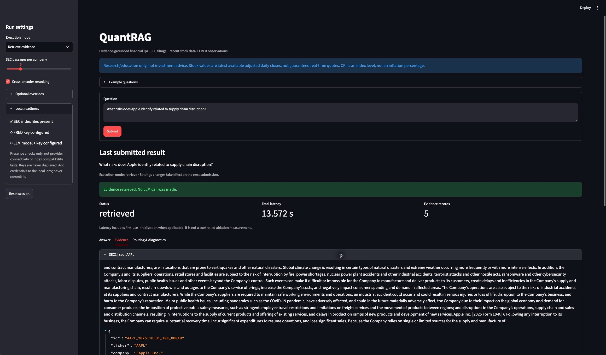

# Task 7/8 verification - 24 October 2026

This record updates the earlier missing-index state. It separates software acceptance from final project-quality evaluation.

## Software and real-data checks

| Check | Observed result |
|---|---|
| Automated suite | 109 tests passed |
| Dependency consistency | `python -m pip check`: no broken requirements |
| Whitespace | `git diff --check`: passed |
| Real SEC + Streamlit AppTest | 7 checks passed |
| Shared BM25 passages / FAISS vectors / dense metadata | 25,976 / 25,976 / 25,976 |
| Retrieval models | BAAI/bge-base-en-v1.5 and cross-encoder/ms-marco-MiniLM-L-6-v2, loaded from cache |
| Providers called in real acceptance | Zero stock, FRED or LLM calls; those entrypoints were guarded |

Runtime: Python 3.11.17, Streamlit 1.66.0, sentence-transformers 6.1.0, FAISS CPU 1.15.1 and PyTorch 2.14.1 on macOS arm64. `HF_HUB_OFFLINE=1` and `TRANSFORMERS_OFFLINE=1` were enabled for real-model checks. No provider credentials are included in this record.

The seven acceptance cases cover route-only preview without backend construction, real Apple evidence retrieval, enabling the real cross-encoder after a no-reranking request in the same session, two-company retrieval, explicit insufficient evidence for an absent company, invalid-filter rejection with stale-result removal, and session reset. The two-company case returned ten distinct passages, five per company. These use actual SEC indexes, not a synthetic retriever. AppTest does not itself establish a visual browser screenshot or a browser download test.

## Five illustrative query checks

The default demonstration set was corrected from JPM/XOM, absent in the supplied snapshot, to AMZN/CVX, which are present. No manually annotated evaluation query, label or previous run artifact was changed. The unavailable-company path remains tested separately.

After a separate initialization (0.847 s) and one warm-up query, one measured hybrid-plus-reranking retrieval was made per question at K=5:

| Company | Question topic | Returned passages | Retrieval time (s) |
|---|---|---:|---:|
| AAPL | Supply-chain disruption risks | 5 | 0.2424 |
| MSFT | Cloud revenue growth | 5 | 0.2205 |
| NVDA | Export restrictions | 5 | 0.2450 |
| AMZN | Fulfillment and logistics | 5 | 0.2448 |
| CVX | Commodity-price risks | 5 | 0.2383 |

These are sequential, warmed single-pass **smoke-test timings**, not final four-way ablation results, full-RAG latency, answer-quality scores or evidence of concurrent scalability. All returned passages had the expected ticker and complete text. No relevance grade was inferred from this check.

Full local evidence is preserved in the ignored run directory `eval/runs/2026-10-24-task7-acceptance/`: `task7-acceptance.json`, `five-supported-smoke.json` and the real-AppTest check script. The first acceptance JSON records implementation commit `fb98fec`; the default-example patch and subsequent annotation-only merge are later changes. The expanded 109-test suite was run after the example patch.

An additional native Chrome check submitted the Apple supply-chain question in Retrieve evidence mode, selected the Evidence tab and expanded SEC1. The browser displayed `retrieved`, five records, complete passage text, the stable ID/filing metadata and the SEC source link. Its displayed total latency (13.572 s) includes first-use pipeline/model initialization and must not be substituted for the warmed runner timings above. The screenshot below is actual retrieved evidence, not a generated answer. Only unrelated Chrome tabs were cropped from the image.



To repeat the five-query check, choose a new output path:

```bash
HF_HUB_OFFLINE=1 TRANSFORMERS_OFFLINE=1 HF_HUB_DISABLE_TELEMETRY=1 \
  OMP_NUM_THREADS=2 TOKENIZERS_PARALLELISM=false \
  python -m src.benchmark_queries --output eval/runs/NEW-RUN/five-supported-smoke.json --top-k 5
```

## Remaining gates

- Team review/merge of `feature/streamlit-ui`; syncing main into the feature branch is not the reverse merge.
- Final adjudicated retrieval qrels, complete annotation collection and actual pre-adjudication agreement from the evaluation owners. `create_annotation_set.py` only creates blank sheets and must not be rerun over completed labels.
- A controlled four-way retrieval run on those qrels, with coverage limitations reported.
- Operator-owned FRED/LLM configuration for real-provider acceptance. No successful real LLM answer, FRED result, downstream human-quality study, provider cost or final project-quality table is claimed here.
- Edit access or owner insertion for the shared Google Docs report. The current account can view it but cannot edit it. Report-ready methods and measured smoke-test observations are in `docs/task7_8_report.md`.
